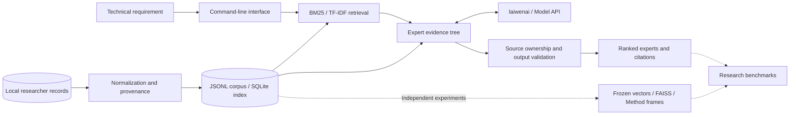

<p align="center">
  
</p>

<p align="center">
  <a href="https://www.python.org/"></a>
  <a href="https://numpy.org/"></a>
  <a href="https://pypi.org/project/laiwenai/"></a>
  <a href="https://github.com/facebookresearch/faiss"></a>
  <a href="LICENSE"></a>
</p>

<h1 align="center">Expert Find Agent</h1>

<p align="center">Find and rank experts for industrial technical needs using traceable evidence from publications and researcher profiles.</p>

## Project Overview

Expert Find Agent is a research prototype for evidence-based expert discovery, industrial R&D collaboration, and conditional method transfer. It connects candidate researchers to their supplied sources and investigates whether documented research methods can address a requested operation.

**Core features:**

- **Expert retrieval:** BM25 and TF-IDF baselines, plus experimental frozen-vector and approximate-search indexes.
- **Evidence navigation:** an expert-to-source tree, bounded source views, and citation ownership checks.
- **Data construction:** original-demand preparation, five-intent bilingual query synthesis, and explicit unresolved audit states.
- **Reproducible evaluation:** public benchmark adapters, timing boundaries, source hashes, and an editable English SIGIR paper.

The CLI provides a hybrid lexical-retrieval and model-assisted evidence-tree workflow. Vector routing, method frames, and newer reasoning strategies are separate research modules. Independent industrial relevance labels and a joint end-to-end accuracy/latency advantage remain research goals.

## Technical Architecture

Python handles normalization, retrieval, evaluation, and command-line execution. JSONL preserves records and provenance; SQLite supports the lexical index. `laiwenai` connects model-assisted stages to a configured OpenAI-compatible service. NumPy and optional FAISS support vector experiments; optional local encoders remain frozen.



Source ownership establishes consistency with supplied records. It does not establish personal contribution, semantic correctness, or future delivery capability. See the [method notes](docs/research-methods.md) and [paper](docs/paper/sigir/main.tex) for the evidence contract and current results.

## Repository Structure

The tree includes local directories created during data preparation and experiments.

```text
.
├── .env                         # Local provider credentials; not tracked
├── .env.example                 # Configuration template
├── .gitignore                   # Local data, credentials, and cache exclusions
├── data/                        # Local raw inputs and downloaded datasets
│   └── teachers/shenzhen/       # Researcher JSONL files and papers.jsonl
├── artifacts/                   # Local corpora, indexes, protocols, and results
├── benchmarks/                  # Redistributable benchmark data
│   └── openalex-author-recovery-v1/
├── docs/                        # Maintained documentation
│   ├── assets/                  # Editable README banner
│   ├── exploration/             # Literature reviews and experiment notes
│   └── paper/sigir/             # English LaTeX main paper and supplement
├── experiments/                 # Reproducible experiment entry points
│   ├── bilingual/               # Synthesis, translation, and retrieval diagnostics
│   ├── metadata/                # Publication dates and citation metadata
│   ├── maintenance/             # Repository language checks
│   └── paper/                   # Result export and PDF builds
├── src/expert_search/           # Python package
│   ├── __main__.py              # CLI entry point
│   ├── agent.py                 # Model-assisted evidence-tree navigation
│   ├── retrieval.py             # Lexical retrieval
│   ├── bilingual/               # Language-specific validation helpers
│   └── metadata/                # Source metadata helpers
├── tests/                       # Automated checks
├── logs/                        # Local execution logs
├── output/pdf/                  # Compiled paper artifacts
├── release/                     # Local source archives
├── tmp/                         # Regenerable temporary files
├── pyproject.toml               # Package metadata and optional dependencies
└── README.md
```

## Quick Start

### Requirements

- Python **3.10+**; the current local environment uses Python 3.11.
- A virtual environment and the dependencies in `pyproject.toml`.
- Local researcher data for the enterprise-search CLI.
- An API key for model-assisted commands; lexical search does not require one.
- Tectonic for paper builds. GPU experiments use separate Slurm environments described in the [cluster guide](docs/cluster.md).

### Installation

```bash
git clone https://github.com/LaiwenAI/expert-find-agent.git
cd expert-find-agent
python3 -m venv .venv
source .venv/bin/activate
python -m pip --isolated install --index-url https://pypi.org/simple -e .
```

Install the optional ANN dependency when needed:

```bash
python -m pip --isolated install --index-url https://pypi.org/simple -e ".[ann]"
```

Other optional environments are defined in `pyproject.toml`; they are not required for the basic lexical CLI.

### Configuration

Run commands from the repository root. Copy the template, then edit `.env`:

```bash
cp .env.example .env
```

```dotenv
LAIWEN_API_KEY=your_api_key_here
LAIWEN_BASE_URL=https://your-provider.example/v1
LAIWEN_MODEL=gpt-6-luna
LAIWEN_TIMEOUT=30.0
LAIWEN_LOG_CONSOLE=False
LAIWEN_LOG_FILE=False
```

Replace the key and example URL with credentials and an endpoint from the same provider. `agent` sends the query and selected researcher material to that configured service. Keep `.env` local.

### Running

First place the expected researcher JSONL files under `data/teachers/shenzhen/`. Profile records use `teacher_id`; `papers.jsonl` links papers through the same field. The supported profile fields are defined in [corpus.py](src/expert_search/corpus.py).

```bash
python -m expert_search prepare --data data
python -m expert_search index
python -m expert_search search "robotic motion control" --method bm25-max -k 5
python -m expert_search agent "Find experts in robotic control and reinforcement learning" -k 3 --candidates 8
```

A source-only checkout can first verify the CLI without loading private data:

```bash
python -m expert_search --help
python -m unittest discover -s tests
```

See the [usage guide](docs/usage.md) for additional methods, data adapters, and experiment commands.

The repository includes an [OpenAlex temporal author-recovery proxy](benchmarks/openalex-author-recovery-v1/README.md) with 99 held-out title queries and known-author associations. It is openly licensed metadata for reproducible baseline checks, not a measure of enterprise suitability or individual contribution.

The experimental candidate-first pipeline combines a compiled candidate language model, selective evidence lookup, and an optional single model call. Its [usage guide](docs/usage.md) describes index creation and verification. It is a research prototype; independent expert-fit evaluation is still pending.

## Development and Maintenance

### Common Commands

```bash
# CLI help and offline checks
PYTHONPATH=src python -m expert_search --help
PYTHONPATH=src python -m unittest discover -s tests
python experiments/maintenance/check_repository_language.py

# Local evaluation reports; requires the corresponding prepared artifacts
PYTHONPATH=src python -m expert_search benchmark
PYTHONPATH=src python -m expert_search report
PYTHONPATH=src python -m expert_search verify

# Compile the committed paper snapshot without private experimental data
python experiments/paper/build_sigir.py --frozen-results

# Refresh paper numbers from local experimental artifacts and compile
python experiments/paper/build_sigir.py
```

### Testing

Run the offline suite after code changes. Relevant checks cover source ownership, snapshot binding, parsing, ranking behavior, and incomplete-result accounting. Model calls and cluster runs are separate experiments; passing unit tests does not establish recommendation accuracy.

For reproducible experiments, preserve input hashes, model settings, terminal failures, and timing boundaries. Report retrieval, encoding, model requests, offline preparation, and complete-result latency separately.

### Data and Files

- `data/`, `artifacts/`, `logs/`, `release/`, `tmp/`, and local environments are excluded from source control.
- Store raw inputs and model traces locally. Do not overwrite original-language source records during translation or normalization.
- Keep source code, documentation, configuration examples, and editable figures in the repository.
- Retain experiment protocols and meaningful negative results; remove regenerable previews and unused temporary files.
- Language-specific schema keys and fixtures use Unicode escapes in source files, preserving bilingual behavior while keeping repository text English. See the [repository language policy](docs/repository-language.md).

The **MIT license applies to repository software**. Original data, literature, upstream benchmarks, and the vendored ACM template retain their own terms. The [source release notes](docs/open-source.md) describe the publication boundary.

### Development Workflow

1. Inspect the existing implementation and related experiment before adding another variant.
2. Freeze the source snapshot, candidate/view scope, model settings, and comparison protocol.
3. Implement the change and run the relevant offline checks.
4. Run model or GPU experiments separately, preserving failed and unresolved records.
5. Update the documentation and paper from verified results, then package the intended source files.

The project explores training-free compositions. A component-level speedup, source match, or model-screened synthetic query is not evidence of complete-system superiority.

## Deployment and Release

The current deliverable is a Python CLI and research package. Install it in a virtual environment on the target machine and provide local data and configuration as described above.

Build the reproducible source archive:

```bash
python experiments/build_release.py
```

This creates `release/expert-find-agent-source.zip` with a per-file SHA-256 manifest. It excludes credentials, raw enterprise/researcher data, model weights, downloaded corpora, and model traces. GPU jobs run on Slurm compute nodes, with project storage under the user's `zdx` directory; the login node is used for submission and monitoring.

Research and release references:

- [SIGIR main paper](docs/paper/sigir/main.tex) and [supplement](docs/paper/sigir/appendix.tex)
- [Paper build instructions](docs/paper/sigir/README.md)
- [Bilingual query construction data card](docs/bilingual-query-data-card.md)
- [Fresh industrial evaluation data card](docs/fresh-evaluation-data-card.md)
- [MERIT suitability benchmark](docs/merit-suitability-card.md)
- [Benchmark results](docs/benchmark-results.md) and [reproduction map](docs/exploration/reproduction-map.md)
- [PageIndex-inspired design review](docs/exploration/pageindex-expert-design.md)
- [Annotation protocol](docs/annotation-protocol.md)

## Frequently Asked Questions

**Why does a fresh checkout fail during `prepare`?**  
The enterprise/researcher raw files are not distributed with the software. Supply the expected local files before building the corpus. Public benchmark adapters have separate preparation steps and source terms.

**Why does `agent` fail while lexical search works?**  
Check the repository-root `.env`, provider URL, API key, and model availability. The lexical path does not call the model service.

**Can the paper compile without private data?**  
Yes. Use `python experiments/paper/build_sigir.py --frozen-results`. Refreshing result tables instead requires the local authoritative experimental artifacts.

**Are the synthetic queries and model judgments human gold labels?**  
No. Construction records retain their screening and unresolved states. See the data cards for the distinction between original needs, derived bilingual intents, source-scoped judgments, and human-rated auxiliary tasks.

**Does a cited paper prove the expert can deliver the requested project?**  
A supplied association and localized passage support a scoped historical claim. Personal contribution, conditional applicability, and future delivery require separate evidence.
